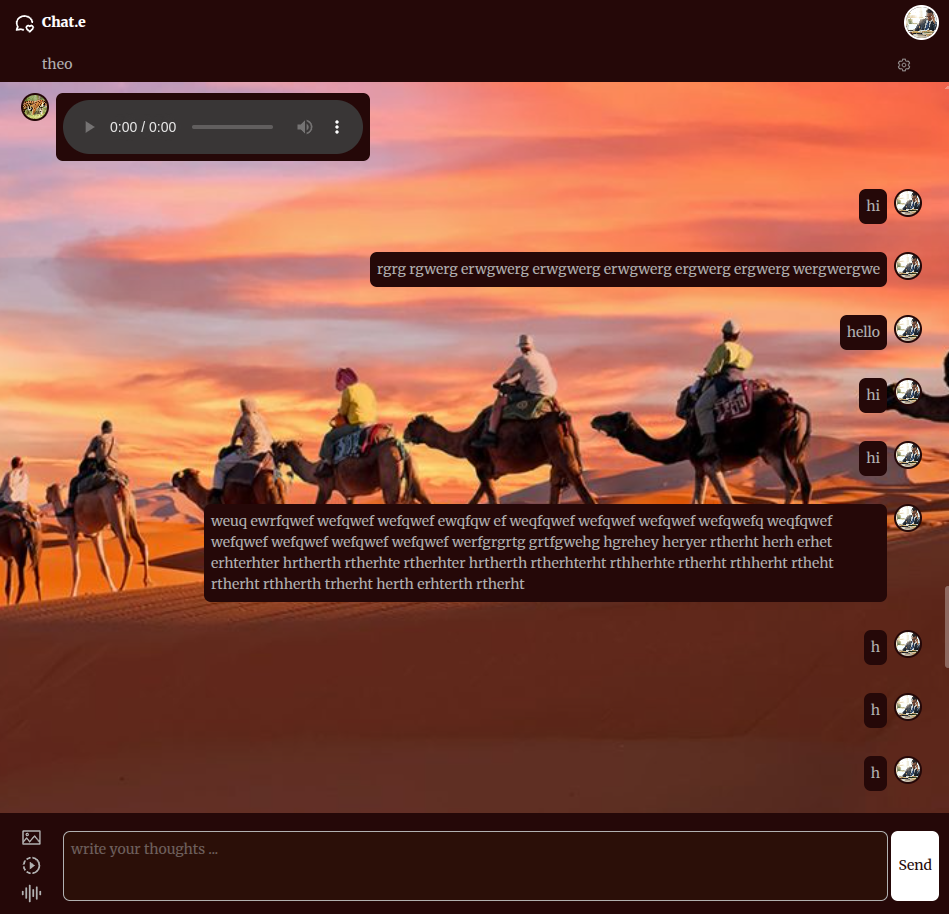

# 💬 Chat.e

This is a real-time chat application that supports one-to-one and group messaging. Users can exchange text messages as well as share photos, videos, and voice recordings instantly. 

👉 **[Live Demo](https://chat-e-ofqb.onrender.com)**

<p align="center">
  
</p>

---

## ✨ Features

- 💬 One-to-one private messaging
- ⚡ Real-time messaging with WebSockets
- 🖼 Send and receive images
- 🎥 Share videos & audios
- 🟢 Online/offline user status
- 🔐 Secure communication 

---

## 🧰 Tech Stack

**Backend:**
- Express.js  
- Socket.IO

**Frontend:**
- React.js
- Tailwind CSS


**Storage:**
- Cloud storage through MongoDB

---


## 📦 Setup Instructions

```
git clone https://github.com/shoaib221/Chat.e.git
cd Chat.e/backend
npm install
npm run dev
```

### Target Problems
- Messaging through web sockets
- Making friends & groups
- Uploading media on cloud storage
